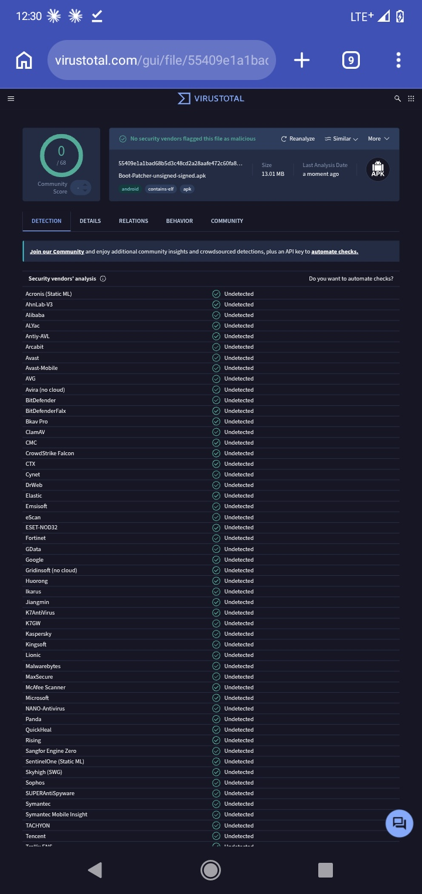
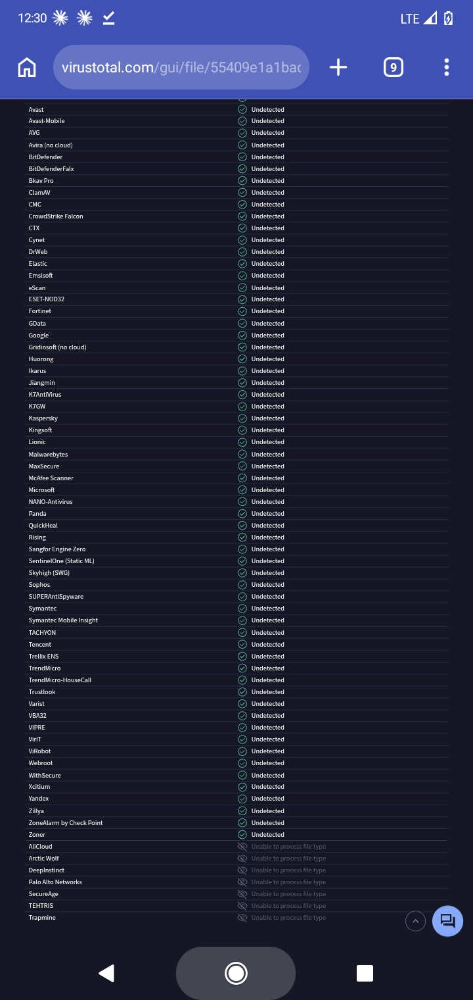

  

<h1 align="center">Boot Patcher</h1>

  A clean White + Blue Android tool for patching boot images and managing root access. 
  Package: <code>com.bootpatcher.manager</code> · Kotlin · Jetpack Compose

---

## Download

** [⬇ Download Boot Patcher APK]() **

*Tap the button above to start the download. Use the VirusTotal report in the Security section to check the file first.*

> The download is a **signed release APK**, ready to install. Allow installs from your browser or file manager when Android asks.

---

> **First time? Install the Magisk app first.** Boot Patcher needs the official Magisk app on your phone for the root permission prompt: **[Download Magisk (official GitHub)](https://github.com/topjohnwu/Magisk/releases)** Credit: Magisk by topjohnwu and contributors.

## What it does

| Area | Features |
|---|---|
| **Boot image patching** | Select an image, validate its header, patch with the official Magisk engine, live terminal-style log. Single Patch and Patch + Backup modes. Options: preserve AVB 2.0 / dm-verity, preserve force encryption, patch vbmeta, recovery mode, randomized output name. Output is saved to `Download/BootPatcher/`. |
| **URL patching** | Download an `https://` image or a ZIP that contains `boot.img` / `init_boot.img` (including a nested ZIP), then patch it. |
| **Superuser manager** | Installed-app list with icons, package, UID and search. Allow, Deny, Revoke, and **+ Add**. Every change is re-read from Magisk and reported as failed if it was not confirmed. |
| **Logs** | Separate **App Access** and **Superuser Permission** cards, verified independently. Tap a card to re-check. Timestamped event log. |
| **Zygisk & DenyList** | Zygisk toggle, DenyList configuration with app search. Adding an app switches enforcement on automatically (recorded in Logs). |
| **Modules** | List, enable/disable, remove/undo and install modules from a ZIP, using Magisk's own installer. |
| **Settings** | Superuser access, mount namespace, diagnostics, install, about. |

**Never silent:** the original image is never modified, and Boot Patcher never flashes a partition. You flash the patched image yourself.

### Some things may not work
Results depend on your device, ROM, firmware and Magisk version. These may not work on every phone:
- **Zygisk**, and anything that relies on it
- **DenyList** (it gives no guarantee that an app will not detect root)
- **Modules** (compatibility is decided by each module and by Magisk, not by Boot Patcher)
- **URL patching**, and patching images from some firmware formats
- Root prompts and Superuser changes if the Magisk app is missing or a previous choice was denied

### Not included
Direct Install, Superuser timeout, update channel, systemless hosts, multiuser mode, user authentication, DNS-over-HTTPS, and OTA `payload.bin` extraction. Magisk offers no documented interface for other apps for these, so they are intentionally not faked.

---

## Getting started

1. **Install** the Boot Patcher APK from the download link.
2. **Patch**: open **Patch**, pick (or download) your *stock* `boot.img` / `init_boot.img` for your exact firmware, choose options, tap **Patch image**, then **Save patched image to Downloads**.
3. **Flash** the patched image yourself (for example with `fastboot`). Keep the original as a backup.
4. **First-time setup: install the official Magisk app** if it is not already installed: **[Magisk releases on GitHub](https://github.com/topjohnwu/Magisk/releases)** (download `Magisk-vXX.X.apk`). Boot Patcher is built on Magisk, created by **topjohnwu** and contributors. On official builds, the root prompt is shown by the Magisk app.
5. **Grant root once**: open **Superuser → Request root**, read the notice, tap **Continue**, then tap **Allow** in the prompt *quickly*. Do not tap Deny or let it time out; Magisk may remember that choice.
6. From now on, manage other apps' root access (Allow / Deny / Revoke) from Boot Patcher.

> **About uninstalling the Magisk app afterwards:** this has not been verified. Some Magisk builds reinstall the app automatically, and others may stop showing root prompts without it. Test on your device before relying on it.

### If Superuser does not work
Once you have patched and flashed with Boot Patcher:

1. Download the official **Magisk app**: **[Download Magisk (GitHub)](https://github.com/topjohnwu/Magisk/releases)**
2. Open **Magisk → Superuser**.
3. Switch **Boot Patcher** on. *(If it is not listed, open Boot Patcher → Superuser → Request root once, then check again.)*
4. Boot Patcher can now manage the root permissions of your other apps.
5. You can then try uninstalling the Magisk app. If root prompts stop working, install it again.

---

## Troubleshooting

| Symptom | Likely cause and fix |
|---|---|
| `exit=13` / "Permission denied" when changing a policy | Boot Patcher itself has no root. Use **Request root** and tap Allow. If it was denied earlier, switch it on once in Magisk → Superuser → Boot Patcher. |
| No root prompt appears | The Magisk app is missing, or Superuser access is disabled in Magisk settings. |
| "Unsupported image" | Only images with the `ANDROID!` header are accepted. Use `boot.img` or `init_boot.img`, not `vendor_boot`. |
| "payload.bin ... not supported" | Extract `boot.img` from the OTA first, or use an image / ZIP that contains it. |
| Patch finishes but phone will not boot | Use the image that matches your exact firmware build. Restore your original image. |

---

## How it works

- The app bundles the official **Magisk** engine binaries and patch scripts, checked against the official release checksum when the app is built. Nothing is downloaded when the app is installed or opened.
- Patching runs the official `boot_patch.sh` on a copy of your image.
- Superuser, Zygisk and DenyList use Magisk's command-line interface and database; every change is read back before success is shown.

---

## Security

| | |
|---|---|
| **File** | `Boot-Patcher-unsigned-signed.apk` (13.01 MB) |
| **SHA-256** | `55409e1a1bad68b5d3c48cd2a28aafe472c60fa8ed8913b5ce07d03028cbedb9` |
| **VirusTotal report** | **[View VirusTotal report](https://www.virustotal.com/gui/file/55409e1a1bad68b5d3c48cd2a28aafe472c60fa8ed8913b5ce07d03028cbedb9)**
| **Result (1 Nov 2026)** | 0 / 68 security vendors flagged the file as malicious |

Verify your download: run `sha256sum <file>` (Linux/macOS) or `certutil -hashfile <file> SHA256` (Windows). The hash must match the one above; if it does not, the file is not the one scanned.

  
  

Notes:
- "0 detections" means no vendor flagged the file at scan time. It is not a guarantee of safety, and results can change. Please check the live report.
- A few engines (AliCloud, Arctic Wolf, DeepInstinct, Palo Alto Networks, SecureAge, TEHTRIS, Trapmine) reported they could not process this file type, so they did not scan it.
- Google Play Protect is a separate system. Because Boot Patcher works with root, Play Protect may show a warning such as "harmful app" or "unrecognized developer".

**Seeing a Play Protect warning?** Check the report first: **[View VirusTotal report](https://www.virustotal.com/gui/file/55409e1a1bad68b5d3c48cd2a28aafe472c60fa8ed8913b5ce07d03028cbedb9)**
If the SHA-256 of your file matches the one above and the report shows no detections, the file is the one that was scanned. You can then choose to install anyway. If you are unsure, do not install.

---

## Disclaimer

**This tool is for educational purposes only.** Boot Patcher is a root tool, provided **"as is", without warranty of any kind**. Use it entirely at your own risk.

**The developer is not responsible for:**
- a bricked phone, boot loop, data loss, or a voided warranty;
- crashes, bugs or unexpected behavior of this app or of your device;
- modules that do not install, do not work, or cause problems (modules are installed by Magisk's own installer, and their compatibility is not guaranteed);
- Zygisk or DenyList not working as expected on your device, ROM or Magisk version (DenyList gives no guarantee that an app will not detect root);
- any other damage, loss or consequence of using, modifying or distributing this software.

Patching, flashing and rooting can permanently damage a device. Always keep a backup of your original boot image, use the image that matches your exact firmware, and make sure you understand each step before you start. If you do not accept these terms, do not use this tool.

---

## License and credits

- **Magisk** by **[topjohnwu](https://github.com/topjohnwu)** and contributors, licensed under **GPL-3.0-or-later**. Source code and releases: **[Magisk on GitHub](https://github.com/topjohnwu/Magisk)** Boot Patcher bundles Magisk components; if you distribute a build that includes them, you must make the corresponding source available under the same license.
- Boot Patcher is an independent project and is not affiliated with or endorsed by the Magisk project.
